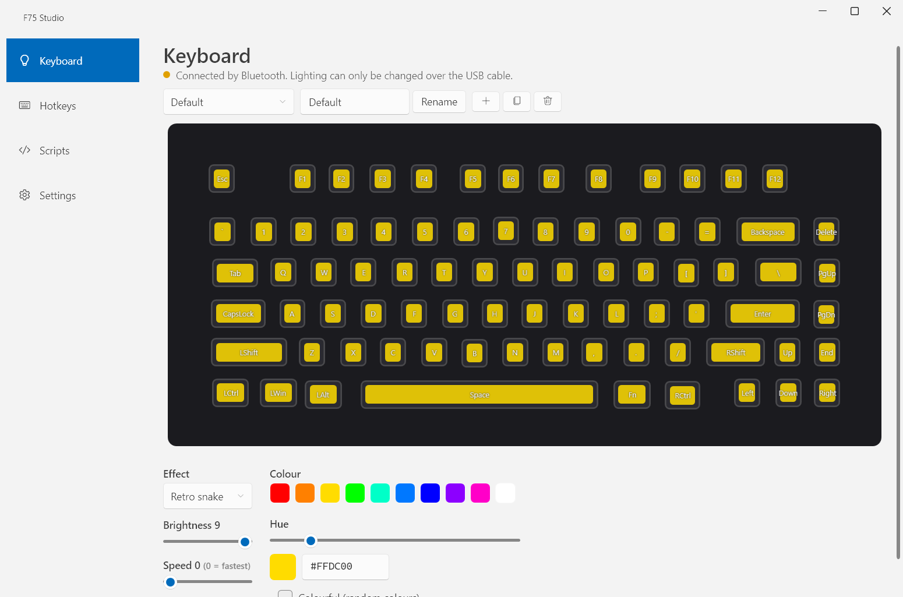
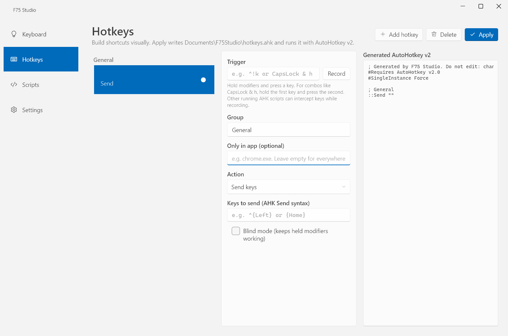

# F75 Studio

A small Windows tray app for the **AULA F75** keyboard. Change the keyboard's lighting without the vendor software, sync the keys to what's on your screen, and build **AutoHotkey v2** hotkeys visually.




## Features

- **Lighting editor.** Pick any of the keyboard's built-in effects (Static, Breathing, Rainbow, Ripples, Retro snake and more), set colour, brightness and speed, and see a live preview of the board.
- **Per-key colours.** Paint individual keys with the Custom per-key effect.
- **Screen sync (edges).** TV-ambilight style: the F-row follows the top of your screen, the bottom row the bottom edge, the side columns the left and right edges.
- **Screen sync (blur).** Each key shows the blurred colour of the matching spot on the screen, so the whole board mirrors the picture.
- **Lighting profiles.** Save, rename, duplicate and switch profiles from the app or from the tray menu.
- **Visual hotkey builder.** Record a trigger, choose an action (send keys, remap a key, type text, run a program or URL, media keys, switch lighting profile, disable a key or custom AHK code), and optionally limit it to one app. F75 Studio writes `Documents\F75Studio\hotkeys.ahk` and runs it with AutoHotkey v2.
- **Script manager.** Start, stop and edit your other `.ahk` scripts, run them at startup, with automatic backups.
- **Stays in the tray.** Switch lighting profiles, pause hotkeys or start scripts from the tray icon.



## How the lighting works

The AULA F75 has no public SDK, so F75 Studio talks to the keyboard directly over USB HID. The protocol was worked out from the wired interface and is documented in [docs/protocol/aula-f75.md](docs/protocol/aula-f75.md).

- Lighting changes need the **USB cable**. Over Bluetooth or the 2.4 GHz dongle the app shows the connection and saves your changes, but sends nothing.
- Every write goes through an allowlist of known-safe commands, and the keyboard's identity is checked before each one. Firmware-update and other risky commands are never sent.
- Screen sync uses **volatile live frames** (about 25 per second) that never touch the keyboard's flash memory. When you switch effects, unplug the cable or lock the PC, the keyboard returns to the profile's saved effect.
- Screen capture uses DXGI Desktop Duplication, downscaled on the GPU to a tiny image. Nothing is saved or sent anywhere.
- Close the official AULA software while using F75 Studio; the two would fight over the keyboard.

## Requirements

- Windows 10 or 11
- AULA F75 (wired USB connection for lighting)
- [AutoHotkey v2](https://www.autohotkey.com) for hotkeys and scripts
- [.NET 8 SDK](https://dotnet.microsoft.com/download/dotnet/8.0) to build (the Desktop Runtime is enough to run a published build)

## Getting started

```bash
git clone git@github.com:releasium/f75-studio.git
cd f75-studio
dotnet run --project src/F75Studio.App
```

To build a single executable:

```bash
dotnet publish src/F75Studio.App -c Release -r win-x64 --self-contained false -p:PublishSingleFile=true -o publish
```

Then run `publish\F75Studio.exe`. Use `--tray` to start hidden in the tray, or `--profile "<name>"` to switch the lighting profile (for example from a hotkey).

Run the tests with:

```bash
dotnet test
```

## Files

- Settings, lighting profiles and hotkey cards: `%AppData%\F75Studio\`
- Generated hotkey script: `Documents\F75Studio\hotkeys.ahk` (rewritten on every Apply; don't edit it by hand)
- Logs: `%AppData%\F75Studio\logs\`

## Project structure

```
src/
  F75Studio.Core/            paths, settings, JSON storage, logging, single instance
  F75Studio.Hotkeys/         hotkey model, AHK v2 generator and importer, script runner
  F75Studio.Lighting/        effects, F75 layout, lighting state, screen-sync engine and mappers
  F75Studio.Lighting.Aula/   AULA F75 HID protocol, device detection, paced writes
  F75Studio.App/             WPF tray app (WPF-UI Fluent design), DXGI screen capture
tests/
  F75Studio.Tests/           xUnit tests
docs/
  protocol/aula-f75.md       the reverse-engineered lighting protocol
```

## Notes

- F75 Studio only tracks scripts it started itself. Scripts already running from elsewhere show as stopped.
- Saving a script keeps the previous version as `<name>.ahk.bak` and, on the first save only, the untouched original as `<name>.ahk.orig`.
- Screen sync pauses on protected content (for example DRM video) and HDR screens it can't capture.
- Not affiliated with or endorsed by AULA.

## License

[MIT](LICENSE)
